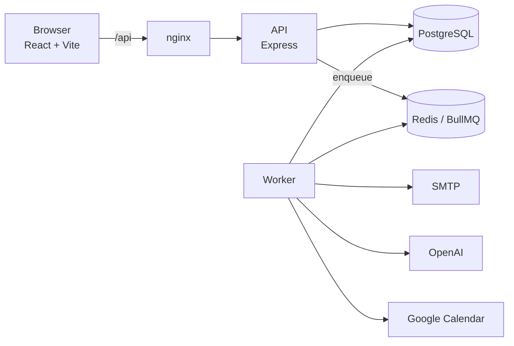
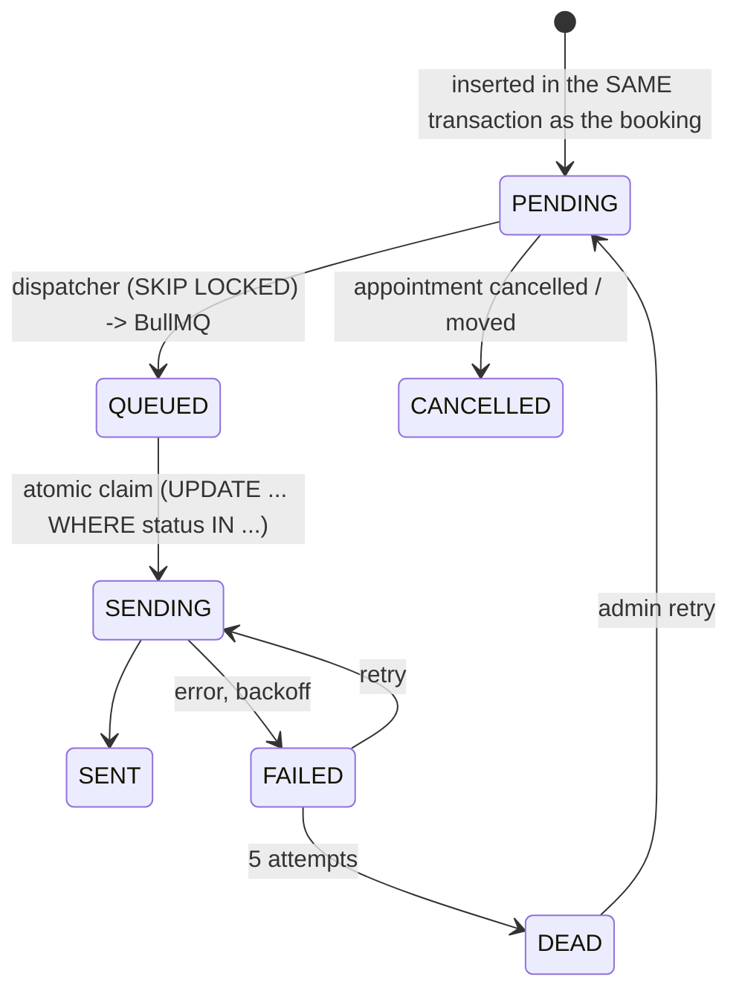
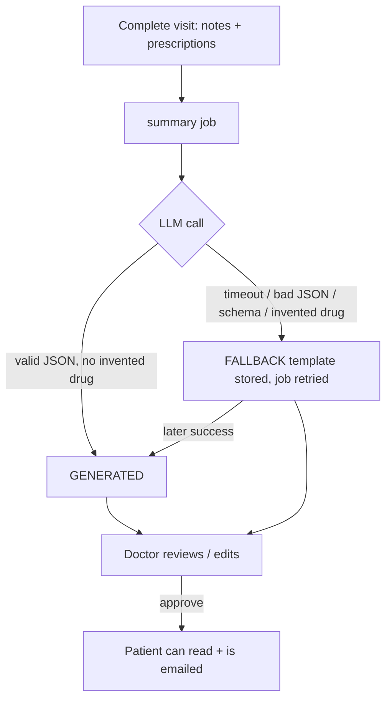

# Architecture



The API never calls email, the LLM or Google on the request path. It writes to Postgres (the source of truth) and enqueues jobs; the worker does the slow, failure-prone work. If Redis, SMTP, OpenAI or Google is down, booking still works.

## Booking without double-booking

```mermaid
sequenceDiagram
  participant P as Patient
  participant API
  participant DB as PostgreSQL
  P->>API: POST /appointments/hold
  API->>DB: BEGIN; SELECT doctor FOR UPDATE
  API->>DB: check hours (doctor tz), leave, expire stale holds
  API->>DB: INSERT HELD (5 min)  -- EXCLUDE gist is the last line of defence
  DB-->>API: ok | exclusion violation -> 409 SLOT_ALREADY_BOOKED
  API-->>P: 201 {hold_expires_at}
  P->>API: POST /appointments/:id/confirm {reason}
  API->>DB: BEGIN; HELD -> CONFIRMED; INSERT notifications (outbox); COMMIT
  API-)Worker: enqueue pre-visit summary, calendar sync
```

Three layers: the doctor-row lock serialises competing bookings (cheap, explicit errors); validation inside the lock gives good messages; the exclusion constraints guarantee the invariant regardless of code paths.

**Lock order is always doctor row → appointment row** (booking, leave creation, reschedule). A reschedule that locked the appointment first could deadlock against a doctor adding leave; there is a test that fires both at once.

## Notification outbox



Reasons: "booked" and "an email will be sent" can't diverge; two workers can't double-send; a crash or Redis flush is repaired by the 30-second reconcile sweep; reminders are re-checked at send time so a cancelled visit is never reminded. Delivery is at-least-once, de-duplicated by `dedupe_key` on insert and a stable `Message-ID`.

## Visit summaries



Only clinically needed fields reach the model (no name, email or ids), inside a `<data>` block treated as untrusted. The UI says whether a summary is AI-drafted, template, or edited by the doctor.

## Security notes
- JWT (HS256, 8 h) with role checks per route; patients only ever see their own data, and only an *approved* post-visit summary.
- Login and sign-up throttles; unknown emails cost the same as wrong passwords (dummy hash).
- Helmet, strict CORS allowlist, 100 kB body limit, zod on every input.
- OAuth `state` is a signed JWT with a purpose claim, so a login token can't be replayed as one.
- Audit log is append-only via trigger; the audit write is best-effort (a failure is logged loudly rather than blocking care).
- Google refresh tokens: AES-256-GCM, versioned prefix, plaintext passthrough only for legacy rows or when no key is configured (dev).

## Where things are
```
server/src/services   booking, leaves, notifications, summaries, calendarSync, audit, availability
server/src/integrations  llm, mailer, calendar, oauth   (interfaces + real + fakes in tests)
server/src/jobs       queues, reconcile
server/sql            001_init.sql, 002_audit_log.sql  (applied in order, advisory-locked)
client/src/pages      patient/, doctor/, admin/
client/e2e            Playwright journey + screenshots
```
